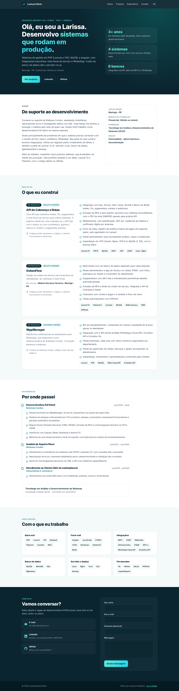
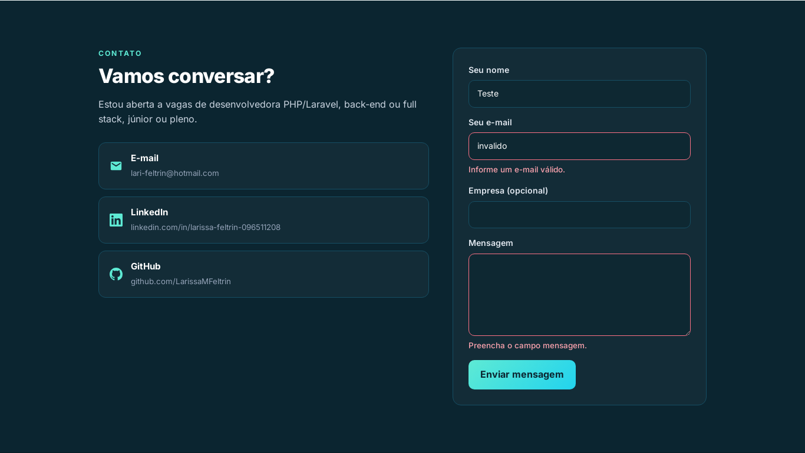
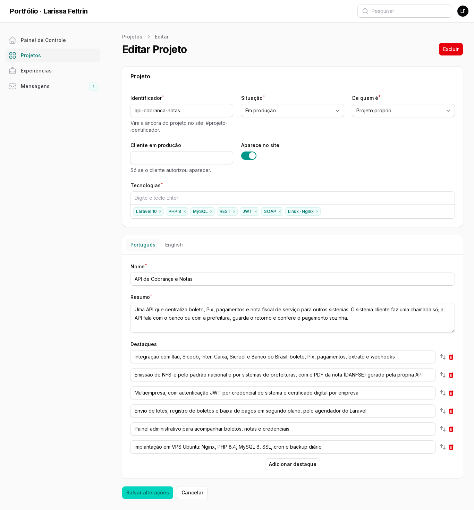

# Portfólio · Larissa Feltrin

[](https://github.com/LarissaMFeltrin/portfolio/actions/workflows/testes.yml)

Meu portfólio de desenvolvedora Full Stack PHP/Laravel, em português e inglês.
O conteúdo (projetos e experiências) é editado por um painel administrativo, e as
mensagens do formulário de contato chegam no painel e por e-mail.

**Laravel 13 · Filament 5 · MySQL · PHPUnit · GitHub Actions**



## O que tem aqui

- **Site em dois idiomas pela rota**: `/` em português e `/en` em inglês. O idioma
  vem do endereço, e não do navegador, para quem recebe o link ver sempre a mesma
  versão ([`DefinirIdioma`](app/Http/Middleware/DefinirIdioma.php)).
- **Conteúdo traduzível no banco, sem pacote**: os campos de texto guardam um JSON
  com um valor por idioma, e o trait [`Traduzivel`](app/Models/Concerns/Traduzivel.php)
  devolve o do idioma atual, voltando para o português quando falta tradução.
- **Painel em Filament** (`/admin`): projetos com abas Português/English, ordem
  arrastando a linha, rascunho que não aparece no site, e caixa de mensagens com
  contador de não lidas.
- **Formulário de contato** ([`ContatoController`](app/Http/Controllers/ContatoController.php)):
  - validação com as mensagens no idioma da página;
  - campo-isca contra robôs, que finge sucesso e não grava nada;
  - limite de mensagens por IP, que volta ao formulário com o texto preenchido em
    vez da página de erro 429;
  - a mensagem é gravada antes do e-mail: SMTP fora do ar não perde o contato.
- **Projetos de terceiros tratados como tal**: um projeto da empresa onde trabalho
  mostra de quem é o produto e não promete código ([`OrigemProjeto`](app/Enums/OrigemProjeto.php)).

| Formulário com erro de validação | Painel: edição de projeto |
| --- | --- |
|  |  |

## Testes

19 testes de feature, em MySQL (o mesmo banco de produção), rodando a cada push
no GitHub Actions junto com o Pint:

- [`InicioTest`](tests/Feature/InicioTest.php): idioma por rota, fallback de
  tradução, rascunhos, ordem e formato de datas por idioma.
- [`ContatoTest`](tests/Feature/ContatoTest.php): gravação e aviso por e-mail,
  validação traduzida, campo-isca, SMTP fora do ar e limite por hora.
- [`PainelTest`](tests/Feature/PainelTest.php): acesso, criação de projeto nos
  dois idiomas e mensagem marcada como lida ao abrir.

## Rodar localmente

Precisa de PHP 8.3+, Composer e MySQL.

```bash
git clone https://github.com/LarissaMFeltrin/portfolio.git
cd portfolio
cp .env.example .env              # ajuste DB_* para o seu MySQL
composer setup                    # instala, gera a chave, migra e carrega o conteúdo
php artisan make:filament-user    # usuário do painel
php artisan serve
```

Site em `http://127.0.0.1:8000`, painel em `http://127.0.0.1:8000/admin`.

O `composer install` publica o JavaScript do Livewire em `public/vendor/livewire`.
Sem isso, um nginx com regra de cache para `*.js` (como a padrão do aaPanel)
procura o arquivo em disco, responde 404 e o painel não funciona.

Testes: crie o banco `portfolio_test` e rode `php artisan test`.

## Estrutura

```
app/Http/Controllers/       InicioController (página), ContatoController (formulário)
app/Http/Middleware/        DefinirIdioma
app/Models/                 Projeto, Experiencia, Mensagem + Concerns/Traduzivel
app/Filament/               recursos do painel e as abas por idioma
lang/{pt_BR,en}/site.php    textos fixos do site
resources/views/secoes/     uma view por seção da página
database/seeders/           o conteúdo publicado (ConteudoSeeder)
```

## Contato

[LinkedIn](https://www.linkedin.com/in/larissa-feltrin-096511208) ·
[lari-feltrin@hotmail.com](mailto:lari-feltrin@hotmail.com)
